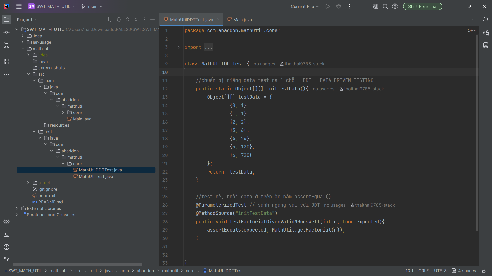

[](https://github.com/Abaddon8386/math-util/actions/workflows/ci-script.yml)

# Welcome to Math Utility

### You will find in this repo the following stuff:

- A Maven project to implement a Math Utility library.
- JUnit test cases to demonstrate Unit Testing and Data-Driven Testing (DDT).
- A foundation for practicing Test-Driven Development (TDD).
- GitHub Actions CI integration (planned).

### Technologies Used

- Java
- Apache Maven
- JUnit 5
- Git & GitHub

### Project Structure

```text
math-util/
├── src/
│   ├── main/java/
│   │   └── com/abaddon/mathutil/
│   └── test/java/
│       └── com/abaddon/mathutil/
├── screen-shots/
├── .gitignore
├── pom.xml
└── README.md
```

### Run Unit Tests

Run the following command from the project directory:

```bash
mvn test
```

### Screen-shots


### Author

**Abaddon8386**

GitHub: https://github.com/Abaddon8386
Email: bevatysun12@gmail.com

© 2026 - Abaddon8386    